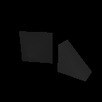

# 培训图册：共享资源使用

> 由 `training/materials/build_atlas.py` 第 3 次运行生成；渲染器 facet-raster-1，全部图版为 128×128、2×2 超采样。
> 服务数据根：`training/data/`（`python3 -m facetproof --root training/data` 可重启查询）。

## 共享资源

| 资源 | 标识 | 状态 | 修订 |
| --- | --- | --- | --- |
| mesh.deck（格栅甲板） | `mesh_a68b8f4aad2749fb98163d1725e44b5b` | usable | 1 |
| mesh.panel（斜翼面板） | `mesh_70a3e62545464ceb9403957ec95b1e3b` | retired | 2 |
| mesh.strut（三角支架） | `mesh_47477e1d80cc4f22810f78d989fa7a73` | usable | 1 |
| pigment.amber（赭橙） | `pigment_357a75e163ea4f14b795a251a43aa1fa` | usable | 1 |
| pigment.teal（釉青） | `pigment_6fd20693a5694d12aad0a175ed3105d2` | usable | 2 |

## 事件影响矩阵

| 事件 | 影响的说明图 | 不受影响的说明图 | 证据 |
| --- | --- | --- | --- |
| 材质修订：釉青 [0.12, 0.62, 0.61] → [0.16, 0.32, 0.85] | fig-06-overview-revised（修订后的新冻结） | fig-01/02/04/05/07/10（全部旧快照及其重渲） | cmp-revised-vs-baseline 颜色差异 1538 像素、轮廓差异 0；cmp-reseal-overview、cmp-reseal-panel 三项差异全 0 |
| 网格停用：斜翼面板 retire | 新冻结被拒 2 起：冻结引用停用网格的草稿、在新草稿放置停用网格（均 409 retired） | fig-01/04/07/10（旧快照 S1 及其重渲） | catalog/evidence/rejections.json；cmp-after-retire 三项差异全 0 |
| 旧快照重渲 | 产生与基线逐像素一致的新图版：fig-04、fig-05、fig-07、fig-10 | — | 重渲图版 visual_hash 与基线完全相等；对应 comparison 三项差异全 0 |
| 批量制作中的单份失败 | fig-09-deck-layout：failed（capacity），重试仍失败 | 同批 fig-10、fig-11 正常成功 | catalog/evidence/batch-round4.json；catalog/failures.json；曝光事件流 |

## 逐图

### fig-01-overview-baseline — 总装说明图（基线）

- 轮次：1 · 状态：**ready** · 教学要点：装配复用共享网格「斜翼面板」（釉青）与「三角支架」（赭橙）的首次冻结渲染。
- 快照 `seal_da80da01fca94744b12108c85a2c57e2`（内容摘要 `292ce629fc003fa0…`）· 图版 `plate_107fa8ddaa3649aeb1490ce062bacb95`（visual_hash `eb0d7368264f207d…`）
- 核验：图版核验 valid · 审阅 accepted · 独立读取器 valid=True · 覆盖像素 2879

  

### fig-02-panel-baseline — 面板特写（基线）

- 轮次：1 · 状态：**ready** · 教学要点：同一共享网格「斜翼面板」与材质「釉青」在第二份装配（正交特写）中的复用。
- 快照 `seal_bb3b3a24d36f4d2d9e8678fcfedbea58`（内容摘要 `b5f58c9955996a81…`）· 图版 `plate_6afeb07af8234a969d69baf34c9a1087`（visual_hash `7ff4f8c06a137b99…`）
- 核验：图版核验 valid · 审阅 accepted · 独立读取器 valid=True · 覆盖像素 5327

  

### fig-03-strut-baseline — 支架特写（基线）

- 轮次：1 · 状态：**ready** · 教学要点：共享网格「三角支架」与材质「赭橙」在第二份装配中的复用。
- 快照 `seal_cda364244ef247509041b24c4f21ae7b`（内容摘要 `b6dcddd732b364ff…`）· 图版 `plate_7f6bddeead0140949c2108fac662379e`（visual_hash `6a0dc5d024b3f491…`）
- 核验：图版核验 valid · 审阅 accepted · 独立读取器 valid=True · 覆盖像素 2976

  

### fig-04-overview-reseal — 总装说明图（材质修订后·旧快照重渲）

- 轮次：2 · 状态：**ready** · 教学要点：材质「釉青」修订后重渲旧快照：与 fig-01 逐像素一致——旧图可复现。
- 快照 `seal_da80da01fca94744b12108c85a2c57e2`（内容摘要 `292ce629fc003fa0…`）· 图版 `plate_b632431169734e9580cbaddc951fb865`（visual_hash `eb0d7368264f207d…`）
- 核验：图版核验 valid · 审阅 accepted · 独立读取器 valid=True · 覆盖像素 2879

  

### fig-05-panel-reseal — 面板特写（材质修订后·旧快照重渲）

- 轮次：2 · 状态：**ready** · 教学要点：旧快照的冻结闭包保留了材质副本，上游修订不影响已冻结说明图。
- 快照 `seal_bb3b3a24d36f4d2d9e8678fcfedbea58`（内容摘要 `b5f58c9955996a81…`）· 图版 `plate_806d401658e041b0af6222c557bfa9bd`（visual_hash `7ff4f8c06a137b99…`）
- 核验：图版核验 valid · 审阅 accepted · 独立读取器 valid=True · 覆盖像素 5327

  

### fig-06-overview-revised — 总装说明图（材质修订后·新冻结）

- 轮次：2 · 状态：**ready** · 教学要点：派生装配在材质修订后重新冻结：几何不变、面板颜色改变——材质修订只影响新冻结。
- 快照 `seal_1f207653ce7c4319a843bd3e1c14598f`（内容摘要 `3434bba292ee2195…`）· 图版 `plate_481f925966ad4147bf5e305756090d48`（visual_hash `8e47f75cecf52035…`）
- 核验：图版核验 valid · 审阅 accepted · 独立读取器 valid=True · 覆盖像素 2879

  

### fig-07-overview-after-retire — 总装说明图（网格停用后·旧快照重渲）

- 轮次：3 · 状态：**ready** · 教学要点：「斜翼面板」停用后旧快照仍可重渲且逐像素一致——停用只限制新冻结。
- 快照 `seal_da80da01fca94744b12108c85a2c57e2`（内容摘要 `292ce629fc003fa0…`）· 图版 `plate_f8914abc8bf34a459597f41ddc2e06a6`（visual_hash `eb0d7368264f207d…`）
- 核验：图版核验 valid · 审阅 accepted · 独立读取器 valid=True · 覆盖像素 2879

  

### fig-08-strut-new — 支架说明图（网格停用后·新冻结）

- 轮次：3 · 状态：**ready** · 教学要点：不引用停用网格的新装配照常冻结渲染——停用限制仅及于引用它的新冻结。
- 快照 `seal_527c05ba30b54493a5b9ddb489adaa7f`（内容摘要 `d7a7cf62b64dcc59…`）· 图版 `plate_49a31d3e5ac64250a7cbd3c3074308d0`（visual_hash `d87a8acdea00681e…`）
- 核验：图版核验 valid · 审阅 accepted · 独立读取器 valid=True · 覆盖像素 2823

  

### fig-09-deck-layout — 整舰布局图（批量·失败）

- 轮次：4 · 状态：**failed** · 教学要点：冻结成功但渲染超出 40000 源面额度：曝光终态 failed，重试仍失败，证据可查询。
- 失败：`capacity`（终态 failed，尝试 2 次，含一次显式重试）——无图版，证据见 `catalog/failures.json`

### fig-10-overview-final — 总装说明图（批量终版）

- 轮次：4 · 状态：**ready** · 教学要点：与 fig-09 同批的成功项：旧快照再次重渲，仍与基线一致。
- 快照 `seal_da80da01fca94744b12108c85a2c57e2`（内容摘要 `292ce629fc003fa0…`）· 图版 `plate_f7ec3606cc33497f976a08188cff1ab8`（visual_hash `eb0d7368264f207d…`）
- 核验：图版核验 valid · 审阅 accepted · 独立读取器 valid=True · 覆盖像素 2879

  

### fig-11-strut-final — 支架说明图（批量终版）

- 轮次：4 · 状态：**ready** · 教学要点：同批成功项：新冻结快照的重渲，与 fig-08 一致。
- 快照 `seal_527c05ba30b54493a5b9ddb489adaa7f`（内容摘要 `d7a7cf62b64dcc59…`）· 图版 `plate_0ec793a9f2ab412084a63a41c104aa71`（visual_hash `d87a8acdea00681e…`）
- 核验：图版核验 valid · 审阅 accepted · 独立读取器 valid=True · 覆盖像素 2823

  
